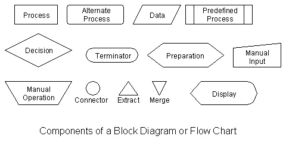

<!-- Imported from TeX.SE by tools/import_stackexchange.py. Trim or paraphrase
     the quoted question, expand the answer, then delete `draft: true`. -->

::: {.callout-note .se-question appearance="simple"}
## The question

[Node shapes in TikZ](https://tex.stackexchange.com/questions/13030/node-shapes-in-tikz), asked by [andrasi](https://tex.stackexchange.com/users/4082/andrasi) on TeX Stack Exchange (2011-03-09; [CC BY-SA 2.5](https://creativecommons.org/licenses/by-sa/2.5/)):

> I want to draw a block diagram for a software app and I need two shapes which I couldn't find on the Internet. The shapes are a parallelogram and a rectangle with double side margins.
>
> One is for data and the other for a predefined process. They look like this:
>
> 
>
>
> Does anyone know how could I draw those two shapes (maybe using TikZ)?
:::

Have a look at https://tex.stackexchange.com/questions/12020/what-is-the-easiest-way-to-draw-3d-cube-with-tikz/12039#12039 (and my answer to it) to see how to define new node shapes in PGF. It should not be too hard to adapt a rectangle shape to get your predefined process node. 

I am on a bus right now so I can't do it for you, maybe later.

::: {.se-attribution}
Originally posted as [an answer](https://tex.stackexchange.com/questions/13030/node-shapes-in-tikz/13034#13034) on TeX Stack Exchange, 2011-03-09. Licensed [CC BY-SA 3.0](https://creativecommons.org/licenses/by-sa/3.0/).
:::
