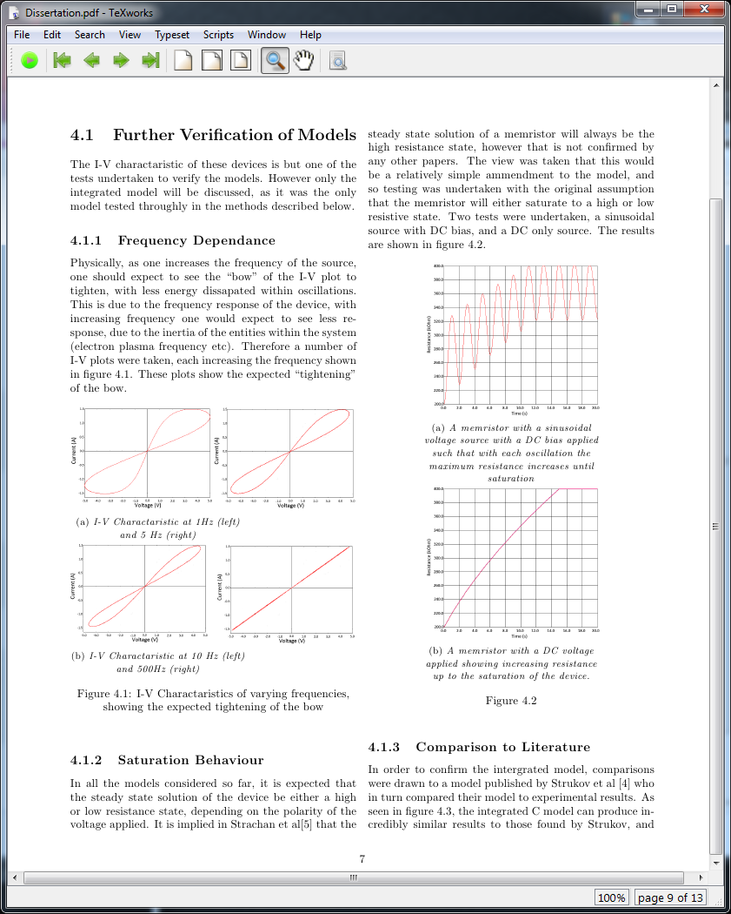

<!-- Imported from TeX.SE by tools/import_stackexchange.py. Trim or paraphrase
     the quoted question, expand the answer, then delete `draft: true`. -->

::: {.callout-note .se-question appearance="simple"}
## The question

[Captions of subfigures not being centered](https://tex.stackexchange.com/questions/107706/captions-of-subfigures-not-being-centered), asked by [TheRandom](https://tex.stackexchange.com/users/28192/therandom) on TeX Stack Exchange (2013-04-09; [CC BY-SA 3.0](https://creativecommons.org/licenses/by-sa/3.0/)):

> 
>
> Figure 4.1 is two subfigures, each with a caption (technically four figures in total, but the ones on rows are one image).
>
> Using
>
> ```latex
> \documentclass[twocolumn,titlepage]{report}
>
>  \usepackage{verbatim}
> \usepackage{amsfonts}
> \usepackage{amsmath}
> %%\usepackage{subfigure}
> \usepackage{amssymb}
> \usepackage[pdftex]{graphicx}
> \usepackage{geometry}
> \usepackage{titlesec}
> \usepackage[center]{caption}
> \usepackage{subcaption}
>
> \titleformat{\chapter}[block]
>  {\normalfont\huge\bfseries}{\thechapter}{1em}{}
>
> \geometry{
>   body={7in, 10in},
>   left=0.75in,
>   top=0.5in
> }
>
> \begin{document}
>
> \begin{figure}[ht]
>        \begin{subfigure}[b]{0.3\textwidth}
>           \includegraphics[width=8.7cm]{fig5-a.png}
> ```
> 	      \caption{\textit{I-V Charactaristic at 1Hz (left) and 5 Hz (right)}}
> 	   \end{subfigure}
>            \begin{subfigure}[b]{0.3\textwidth}
>               \includegraphics[width=8.7cm]{fig8.png}
> 	      \caption{\textit{I-V Charactaristic at 10 Hz (left) and 500Hz (right)}}
> 	\end{subfigure}
>         \caption{I-V Charactaristics of varying frequencies, showing the expected tightening of the bow}
>         \label{fig:freqdep}
>      \end{figure}    
>     \end{document}
> the captions are not aligned under the entire figure. Ideally the caption would spread right across the width of both plots in figure 4.1 a
:::

You have specified the width of each subfigure to be `0.3\textwidth`, and that sets the width of the caption.  But the included graphic is much wider, so it sticks out.  

To fix, set the width of the subfigure to be the full column width:

```latex
\documentclass[twocolumn]{article}
\usepackage[draft]{graphicx}
\usepackage{subcaption}
\begin{document}
   \begin{figure}[ht]
      \begin{subfigure}[b]{\columnwidth}
         \includegraphics[width=\columnwidth]{fig5-a.png}
         \caption{\textit{I-V Charactaristic at 1Hz (left) and 5 Hz (right)}}
      \end{subfigure}
      \begin{subfigure}[b]{\columnwidth}
          \includegraphics[width=\columnwidth]{fig8.png}
          \caption{\textit{I-V Charactaristic at 10 Hz (left) and 500Hz (right)}}
      \end{subfigure}
      \caption{I-V Charactaristics of varying frequencies, showing the expected tightening of the bow}
      \label{fig:freqdep}
   \end{figure}
\end{document}
```

(Thanks to egreg for the helpful comment.)

::: {.se-attribution}
Originally posted as [an answer](https://tex.stackexchange.com/questions/107706/captions-of-subfigures-not-being-centered/107713#107713) on TeX Stack Exchange, 2013-04-09. Licensed [CC BY-SA 3.0](https://creativecommons.org/licenses/by-sa/3.0/).
:::
