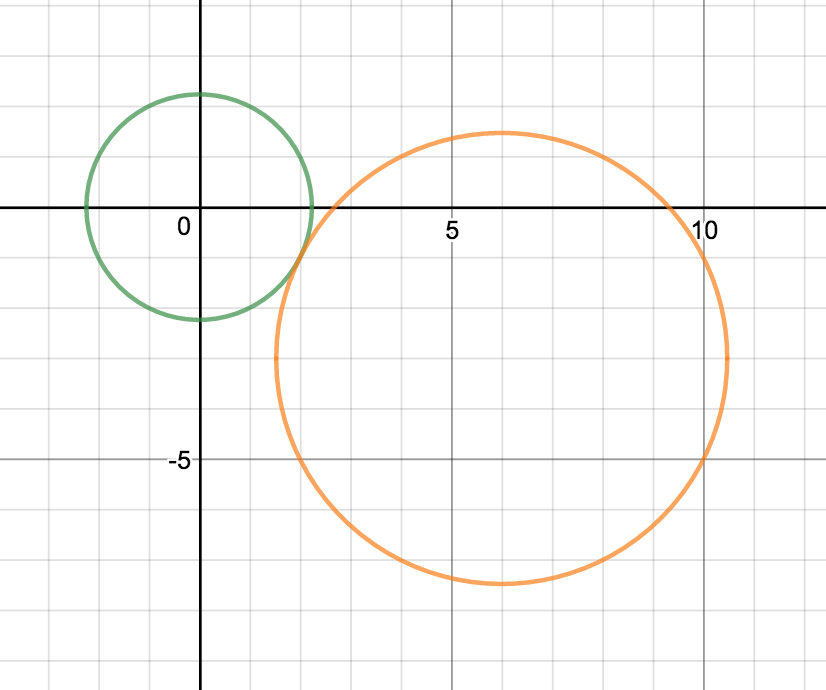

<!-- Imported from Math.SE by tools/import_stackexchange.py. Trim or paraphrase
     the quoted question, expand the answer, then delete `draft: true`. -->

::: {.callout-note .se-question appearance="simple"}
## The question

[Point of Tangency between Two Circles](https://math.stackexchange.com/questions/2297742/point-of-tangency-between-two-circles), asked by [Brianna](https://math.stackexchange.com/users/449831/brianna) on Mathematics Stack Exchange (2017-05-26; [CC BY-SA 3.0](https://creativecommons.org/licenses/by-sa/3.0/)):

> I made sure to look around this site a couple times before asking my question. A lot of people have already asked how to find the point of tangency or intersection between two circles, but none of them could really help me solve the problem.
>
> I'm being asked to **find the point of tangency between two circles** and all I am given are just the two circles -- no equations of tangent lines, etc. Here's a picture of what I'm working with:
>
> 
>
> The equation of the green circle is $x^2$ + $y^2$ = 5.
>
> The equation of the orange circle was given as $x^2$ - 12x + $y^2$ + 6y = -25, which I rewrote as ($x-6)^2$ + $(y+3)^2$ = 20.
>
> How do I find the coordinates of the circles' point of tangency?
>
> Thank you in advance!
:::

The equations are:
$$\begin{gather}
    x^2 + y^2 = 5 \tag{1} \\
    x^2 -12x + y^2 + 6y + 25 = 0 \tag{2}
\end{gather}$$
If you substitute  (1) into (2), you get
$$\begin{align}
    -12 x + 6y + 30 &= 0 \implies y=2x-5\tag{3}
\end{align}$$
Substitute this back into (1):
$$\begin{align}
    x^2 + (2x-5)^2 &= 5 \\\implies
    x^2 + 4x^2 - 20x + 25 &= 5 \\\implies
    5x^2 - 20x + 20 &= 0 \\\implies
    x^2 -4 x + 4 &= 0 \\\implies
    (x-2)^2 &= 0
\end{align}$$
Therefore $x=2$.  By (3), $y=-1$.

::: {.se-attribution}
Originally posted as [an answer](https://math.stackexchange.com/questions/2297742/point-of-tangency-between-two-circles/2297754#2297754) on Mathematics Stack Exchange, 2017-05-26. Licensed [CC BY-SA 3.0](https://creativecommons.org/licenses/by-sa/3.0/).
:::
