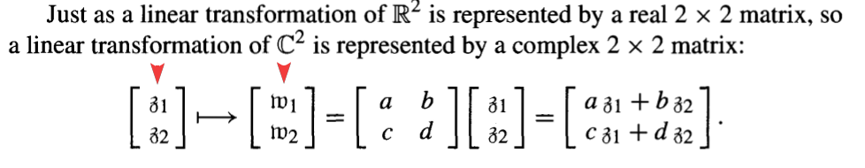

<!-- Imported from Math.SE by tools/import_stackexchange.py. Trim or paraphrase
     the quoted question, expand the answer, then delete `draft: true`. -->

::: {.callout-note .se-question appearance="simple"}
## The question

[What are these characters notates for homogeneous coordinates?](https://math.stackexchange.com/questions/2517568/what-are-these-characters-notates-for-homogeneous-coordinates), asked by [Ooker](https://math.stackexchange.com/users/157643/ooker) on Mathematics Stack Exchange (2017-11-13; [CC BY-SA 3.0](https://creativecommons.org/licenses/by-sa/3.0/)):

> This image is captured from Needham, Visual Complex Analysis:
>
> 
>
> What are those characters called? How to type them in LaTeX? None of them appears in [Homogeneous coordinates](https://en.wikipedia.org/wiki/Homogeneous_coordinates), [Variations of "z"](https://en.wiktionary.org/wiki/Appendix:Variations_of_%22z%22) or [Hebrew alphabet](https://en.wikipedia.org/wiki/Hebrew_alphabet).
:::

It's a fraktur $z$ ($\mathfrak{z}$, `\mathfrak{z}`) and $w$ ($\mathfrak{w}$, `\mathfrak{w}`).  Usually fraktur letters are used for ideals in commutative rings, or Lie algebras, rather than variables.

::: {.se-attribution}
Originally posted as [an answer](https://math.stackexchange.com/questions/2517568/what-are-these-characters-notates-for-homogeneous-coordinates/2517571#2517571) on Mathematics Stack Exchange, 2017-11-13. Licensed [CC BY-SA 3.0](https://creativecommons.org/licenses/by-sa/3.0/).
:::
