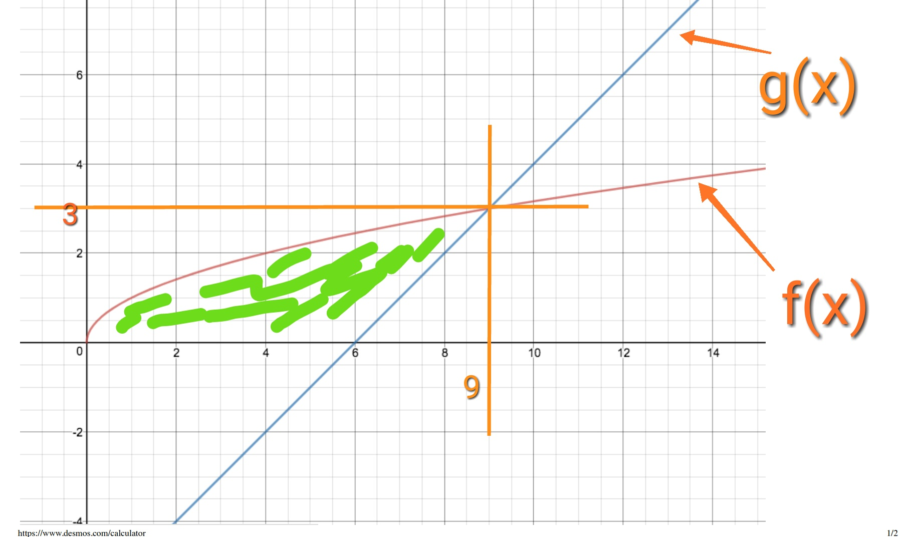

<!-- Imported from Math.SE by tools/import_stackexchange.py. Trim or paraphrase
     the quoted question, expand the answer, then delete `draft: true`. -->

::: {.callout-note .se-question appearance="simple"}
## The question

[Find the area of the region bounded by the curves $y =\sqrt x$, $y=x-6$ and the x-axis by integral with respect to x](https://math.stackexchange.com/questions/2546172/find-the-area-of-the-region-bounded-by-the-curves-y-sqrt-x-y-x-6-and-the), asked by [axelmukwena](https://math.stackexchange.com/users/478920/axelmukwena) on Mathematics Stack Exchange (2017-12-01; [CC BY-SA 3.0](https://creativecommons.org/licenses/by-sa/3.0/)):

> > Find the area (in green) of the region bounded by the curves $f(x) =\sqrt x$,  $g(x)=x-6$ and the x-axis  by integral with respect to x
> 
>
> Attempt:
>
> since $x-6 =\sqrt x$
>
> $x=9$
>
> $A = \displaystyle\int _a^b [f(x)-g(x)] dx$
>
> $A = \displaystyle\int _0^9 \sqrt x -\int _0^9x-6$
>
> $=\frac{2}{3}(9)^{\frac{3}{2}}-\left(\frac{1}{2}(9)^2-6(9)\right)$
>
> $=31.5$ $unit^2$
>
> I don't think this method is correct since I am not getting the same area when I solve the integral with respect to y which is also different when I take the whole area under f(x) then subtract the area of the triangle on the right (base=3, height=3)
>
> Can anyone help?
:::

Unfortunately, your integral grabs too much region.  It's more like this:

[![enter image description here][1]][1]

To get just the area of the green region, you would have to use two separate integrals.
$$A = \int_0^6 \sqrt{x}\,dx + \int_6^9\left(\sqrt{x} - (x-6)\right)\,dx$$

Alternatively, you can integrate with respect to $y$.  The right edge can be expressed as $x=y+6$, the left as $x=y^2$, between $y=0$ and $y=3$.  So the area is
$$A = \int_0^3 (y+6 - y^2)\,dy$$
I hope that helps.

  [1]: jrpqz.png

::: {.se-attribution}
Originally posted as [an answer](https://math.stackexchange.com/questions/2546172/find-the-area-of-the-region-bounded-by-the-curves-y-sqrt-x-y-x-6-and-the/2546184#2546184) on Mathematics Stack Exchange, 2017-12-01. Licensed [CC BY-SA 3.0](https://creativecommons.org/licenses/by-sa/3.0/).
:::
