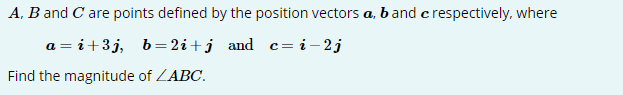

<!-- Imported from Math.SE by tools/import_stackexchange.py. Trim or paraphrase
     the quoted question, expand the answer, then delete `draft: true`. -->

::: {.callout-note .se-question appearance="simple"}
## The question

[For the question attached, how would you find the values of the vectors BA and BC?](https://math.stackexchange.com/questions/2949945/for-the-question-attached-how-would-you-find-the-values-of-the-vectors-ba-and-b), asked by [wendy](https://math.stackexchange.com/users/602615/wendy) on Mathematics Stack Exchange (2018-10-10; [CC BY-SA 4.0](https://creativecommons.org/licenses/by-sa/4.0/)):

> I know that first, you would use the rule  
>
> vector BA x vector BC= |vector BA| * |vector BC| * cos[x]
> and then find the values of vectors BA and BC in terms of a, b and c but I'm not sure as to how...
>
> 
:::

Yes, you want to use the rule
$$\overrightarrow{BA} \cdot \overrightarrow{BC}
    = \left|\overrightarrow{BA}\right| \left|\overrightarrow{BC}\right| \cos(\angle ABC)$$
When it says “$A$ is the point defined by the position vector $\mathbf{a} = \mathbf{i} + 3\mathbf{j}$,” it means $A$ is the point $(1,3)$.  Similarly, you can find the coordinates of $B$ and $C$, and from those the components of $\overrightarrow{BA}$ and $\overrightarrow{BC}$.

::: {.se-attribution}
Originally posted as [an answer](https://math.stackexchange.com/questions/2949945/for-the-question-attached-how-would-you-find-the-values-of-the-vectors-ba-and-b/2949951#2949951) on Mathematics Stack Exchange, 2018-10-10. Licensed [CC BY-SA 4.0](https://creativecommons.org/licenses/by-sa/4.0/).
:::
