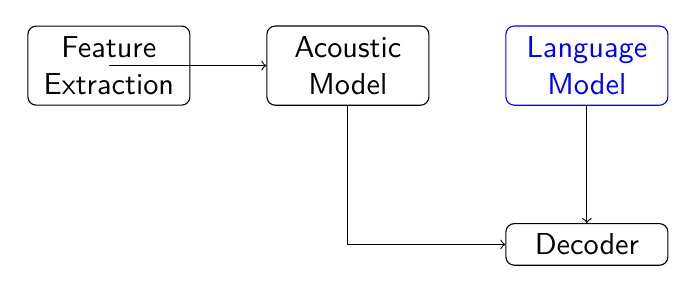

<!-- Imported from TeX.SE by tools/import_stackexchange.py. Trim or paraphrase
     the quoted question, expand the answer, then delete `draft: true`. -->

::: {.callout-note .se-question appearance="simple"}
## The question

[How to make beamer overlays with Tikz node](https://tex.stackexchange.com/questions/6135/how-to-make-beamer-overlays-with-tikz-node), asked by [Peter Smit](https://tex.stackexchange.com/users/459/peter-smit) on TeX Stack Exchange (2010-11-29; [CC BY-SA 2.5](https://creativecommons.org/licenses/by-sa/2.5/)):

> I have a diagram of 4 nodes in my beamer slide.
>
> ```latex
>   \begin{figure}[h]
>   \begin{centering}
>   \begin{tikzpicture}[system/.style={draw,rectangle,rounded corners=3,minimum width=2cm,text width=1.8cm,text centered}]
>     \node [system] (fe) {Feature Extraction};
>     \node [system] (am) [right=of fe] {Acoustic Model};
>     \node [system] (lm) [right=of am] {Language Model};
>     \node [system] (d) [below=of lm] {Decoder};
>
>     \draw[->] (fe) |- (am);
>     \draw[->] (am) |- (d);
>     \draw[->] (lm) -- (d.north);
>
>   \end{tikzpicture}
>   \end{centering}
>   \end{figure}
> ```
>
> How can I in a second slide “highlight” one of the nodes, like I can 
> do with `<alert@n>` for a item in a list?
>
> With highlighting I mean for example giving a color and thickening the lines.
:::

* * *

The key system provided by PGF and TikZ is extremely powerful. One killer 
feature is that the argument specification as with an ordinary TeX macro. So we can declare that a TikZ key take a beamer overlay specification argument, delimited as it is in beamer by angle brackets.

If we want the rest of the key to be processed conditional on the overlay
specification returning true, we use `\pgfkeysalso`. 

All we need is one command:

```latex
\tikzset{onslide/.code args={<#1>#2}{%
  \only<#1>{\pgfkeysalso{#2}} 
}}
```

Using `\pgfkeysalso` doesn't reset the current key path, whereas `\pgfkeys` or `\tikzset` would.  The `.code args` key handler means that

```latex
onslide=<overlay specification>{keys}
```

causes the the following code to be expanded:

```latex
\only<overlay specification>{\pgfkeysalso{keys}}
```

Then you can use the key `onslide=<overlay specification>{keys}` to set keys
only on specific slides.  The slightly inelegant twist is that if your overlay
specification contains commas the entire pair of overlay spec and keys has to be
embraced.  

Here is a complete example:

```latex
\documentclass{beamer}
\usepackage{tikz}
\usetikzlibrary{positioning}

\tikzset{onslide/.code args={<#1>#2}{%
  \only<#1>{\pgfkeysalso{#2}} % \pgfkeysalso doesn't change the path
}}
\tikzset{temporal/.code args={<#1>#2#3#4}{%
  \temporal<#1>{\pgfkeysalso{#2}}{\pgfkeysalso{#3}}{\pgfkeysalso{#4}} % \pgfkeysalso doesn't change the path
}}

\tikzstyle{highlight}=[red,ultra thick]


\begin{document}
\begin{frame}
 \begin{figure}[h]
  \begin{centering}
  \begin{tikzpicture}[
  	system/.style={draw,rectangle,rounded corners=3,minimum width=2cm,text width=1.8cm,text centered},
  	node distance=2cm
  ]
    \node [system,onslide=<3->{highlight},anchor=center] (fe) {Feature Extraction};
    \node [system,onslide={<2,4>{green}}] (am) [right=of fe.center] {Acoustic Model};
    \node [system,temporal=<3>{blue}{highlight}{green}] (lm) [right=of am.center] {Language Model};
    \node [system] (d) [below=of lm.center] {Decoder};

    \draw[->] (fe) |- (am);
    \draw[->] (am) |- (d);
    \draw[->] (lm) -- (d.north);

  \end{tikzpicture}
  \end{centering}
  \end{figure}
\end{frame}
\end{document}
```

{fig-alt="Animation cycling through four beamer slides of a block diagram (Feature Extraction, Acoustic Model, Language Model, Decoder). Slide 1: Language Model is blue. Slide 2: Acoustic Model turns green. Slide 3: Feature Extraction and Language Model are thick and red. Slide 4: Feature Extraction stays red; Acoustic Model and Language Model are green."}

You will be disappointed about the jiggling of your picture when the line thickness keys are applied.  You might have to avoid relative positioning to make that go away.  

For more on key handlers like `.code args`, see the `pgfkeys` section of the TikZ-PGF manual.

This answer led to the [`aobs-tikz` package](https://ctan.org/pkg/aobs-tikz?lang=en) and the `overlay-beamer-styles` TikZ library. I revisited this example with that library in 2026: [Beamer overlays on TikZ nodes, revisited](/blog/posts/2026-11-23-beamer-overlays-tikz-revisited/).


::: {.se-attribution}
Originally posted as [an answer](https://tex.stackexchange.com/questions/6135/how-to-make-beamer-overlays-with-tikz-node/6155#6155) on TeX Stack Exchange, 2010-11-29. Licensed [CC BY-SA 4.0](https://creativecommons.org/licenses/by-sa/4.0/).
:::
