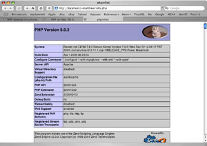

::: {.callout-note .legacy appearance="simple"}
This post is from the blog I kept as Preceptor in Mathematics at Harvard (2005–2008). It's kept here as an archive; some links are dead and references are dated.
:::

\
I’m reviewing a new book on PHP5 and since they wanted me to check it for technical accuracy. The only problem for me was that I haven’t done actual PHP programming for a while and in fact never used PHP5. I was worried about clobbering old PHP4 installations. Luckily, however, it is a cinch to install, even on a Mac, with apxs. All I had to do was follow\
[these instructions](http://developer.apple.com/internet/opensource/php.html) and I was good to go.

Notice the bunny rabbit instead of the PHP logo; that must have been an April Fool’s prank.
