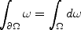
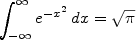

::: {.callout-note .legacy appearance="simple"}
This post is from the blog I kept as Preceptor in Mathematics at Harvard (2005–2008). It's kept here as an archive; some links are dead and references are dated.
:::

I’m trying the [LaTeXRender](http://www.mayer.dial.pipex.com/tex.htm#latexrender) [plugin](http://sixthform.info/steve/wordpress/index.php?cat=2) by [Sixthform](http://sixthform.info/steve/wordpress/index.php). Installation is easy, but at first I got no formulas, only error messages.

Using some of the hints found on the [“Path problems in Linux”](http://sixthform.info/steve/wordpress/index.php?p=34#comments) post, I was able to figure out what was going on.

My server’s “convert” command didn’t understand the “-trim” option. I was able to get reasonable results by using “-crop 0×0″ in the same place. That is, in the file class.latexrender.php, change this line:\
\
`$command = $this->_convert_path." -density ".$this->_formula_density.`\
`" -trim -transparent \"#FFFFFF\" ".$this->_tmp_filename.".ps ".`\
`$this->_tmp_filename.".".$this->_image_format;`\
\
to\
\
`$command = $this->_convert_path." -density ".$this->_formula_density.`\
`" -crop 0x0 -transparent \"#FFFFFF\" ".$this->_tmp_filename.".ps ".`\
`$this->_tmp_filename.".".$this->_image_format;`\
\
This doesn’t crop the image to 0×0, but trims to the smallest rectangle that includes all non-background data. See the [convert man page](http://amath.colorado.edu/computing/software/man/convert.html)

Here is a test: {align="absmiddle"}. It does seem to crop a bit off the right of the omega character.

Another test: {align="absmiddle"}.
