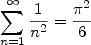

::: {.callout-note .legacy appearance="simple"}
This post is from the blog I kept as Preceptor in Mathematics at Harvard (2005–2008). It's kept here as an archive; some links are dead and references are dated.
:::

I’ve rediscovered (after having forgotten its name) [tex2mail](http://www.tug.org/tex-archive/support/tex2mail/), a nifty perl script that converts equations written in TeX or LaTeX to ASCII art. It’s not beautiful, but it works and is especially useful when discussing math over e-mail. On the Mac, you can use a cheap AppleScript to grab a selection and pipe it through this script, and you’ve got ASCII equations in your fancy mail user agent.

`<!-- more -->`{=html}

For instance, the LaTeX code

\
`\sum_{n=1}^\infty \frac{1}{n^2} = \frac{\pi^2}{6}`\

which would be written in a real mathematics document as {align="absmiddle"}, becomes after tex2mail

                                                2
                                 ~~   oo1   pi
                                  >     -- = ----
                                 /__ i=1 2    6
                                        n

Okay, so that’s not perfect, but it’s 90% there; you can clean it up if you want.

Once you’ve downloaded the perl script, put it in some directory where you keep scripts (\~/bin or \~/Library/Scripts, perhaps), then create [an AppleScript like this](/files/Convert_TeX_text_to_ASCII.scpt):

` `

    tell application "Microsoft Entourage"
         set theText to the selection
         if the class of theText is not Unicode text then
              error "Please select some text before running this script."
              quit
         end if
         set scriptName to "/your/path/to/tex2mail.pl"
         set replacementText to do shell script "echo '" & theText & "' | " & scriptName
         set the selection to replacementText
    end tell

`</code>`{=html}

(I am a wordpress newbie so I don’t know why all my quote characters got escaped there. They shouldn’t be in your script. Alternatively, you can download the script.)

You can save this script in a directory that your mail user agent looks in for scripts. For instance, with Microsoft Entourage, the directory is “\<your Home Directory\>:Documents:Microsoft User Data:Entourage Script Menu Items” (unless you’ve changed the Microsoft User Data folder name somewhere in your Office preferences). Now in Entourage you can select some text, then choose your script from the menu that has the script icon. Hey presto! Cruddy ASCII equations.
