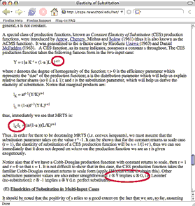
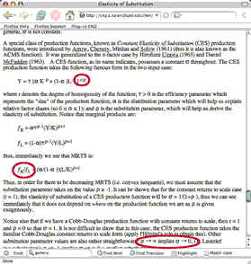

::: {.callout-note .legacy appearance="simple"}
This post is from the blog I kept as Preceptor in Mathematics at Harvard (2005–2008). It's kept here as an archive; some links are dead and references are dated.
:::

I found a nice little entry on everything2 about how to [Make pages using the Symbol font display correctly in Mozilla/Firefox](http://www.everything2.com/index.pl?node_id=1689425). Very helpful.

If you’re a Mac user and you surf for math on the web, you run into a lot of crazy notation.

The problem is that Microsoft Word files which have mathematical symbols are encoded with the FONT element in HTML, which flies in the face of web standards.\
There is a solution — go through the FONT elements with the FACE attribute set to “Symbol”, and remap those characters to the right unicode entities. The everything2 article the text of a JavaScript bookmarklet; you have to remove the newlines before saving it. Or you can just drag this link to your bookmarks bar: [Convert Symbol Font to Unicode](javascript:var%20view%20=%20document.defaultView;%20var%20symboltab%20=%5B0,0,0,0,0,0,0,0,0,0,0,0,0,0,0,0,0,0,0,0,0,0,0,0,0,0,0,0,0,0,0,0,0,0,8704,0,8707,0,0,8715,0,0,8727,0,0,8722,0,0,0,0,0,0,0,0,0,0,0,0,0,0,0,0,0,0,8773,913,914,935,8710,917,934,915,919,921,977,922,923,924,925,927,928,920,929,931,932,933,962,8486,926,936,918,0,8756,0,8869,0,8254,945,946,967,948,949,966,947,951,953,981,954,955,956,957,959,960,952,961,963,964,965,982,969,958,968,950,0,0,0,8764,0,0,0,0,0,0,0,0,0,0,0,0,0,0,0,0,0,0,0,0,0,0,0,0,0,0,0,0,0,0,0,0,0,0,978,8242,8804,8725,8734,402,9827,9830,9829,9824,8596,8592,8593,8594,8595,176,177,8243,8805,215,8733,8706,8226,247,8800,8801,8776,8230,0,0,8629,8501,8465,8476,8472,8855,8853,8709,8745,8746,8835,8839,8836,8834,8838,8712,8713,8736,8711,174,169,8482,8719,8730,8901,172,8743,8744,8660,8656,8657,8658,8659,9674,9001,174,169,8482,8721,0,0,0,0,0,0,0,0,0,0,0,9002,8747,8992,0,8993,0,0,0,0,0,0,0,0,0,0%5D;%20function%20convNode(n)%20%7B%20var%20n1;%20if%20(n%20==%20null)return;%20if%20(n.nodeType%20==%203)%20%7B%20elem%20=%20n.parentNode;var%20st%20=%20view.getComputedStyle(elem,%20null);%20var%20val%20=st.getPropertyValue('font-family');%20if(val.toLowerCase()%20==%20'symbol')%20%7B%20var%20s0%20=%20n.data,s1%20=%20'',%20len%20=%20s0.length,%20ch;%20for%20(i%20=%200;%20i%20%3C%20len;i++)%20%7B%20ch%20=%20s0.charCodeAt(i);%20if%20(ch%20%3C%20256%20&&symboltab%5Bch%5D%20!=%200)%20ch%20=symboltab%5Bch%5D;%20s1%20+=%20String.fromCharCode(ch);%7D%20n.data%20=%20s1;%20%7D%20%7D%20n1%20=%20n.firstChild;%20while%20(n1%20!=null)%20%7B%20convNode(n1);%20n1%20=%20n1.nextSibling;%20%7D%20%7DconvNode(document);). The result is readable as intended.

I confess that Safari is still my browser of choice, and I only got this to work in full-DOM-compliant Firefox. However, if you install the Debug menu in Safari (via preferences), you get the option to open the page you’re currently viewing in Safari in any other browser installed on your computer. So it’s only a two-step process when you see a bad page: open in Firefox, select bookmarklet.
