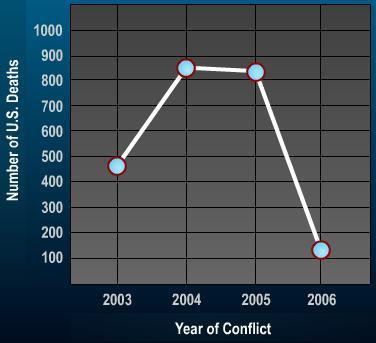
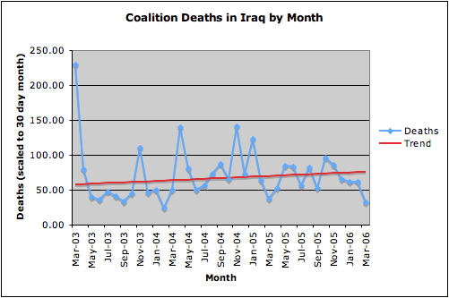

::: {.callout-note .legacy appearance="simple"}
This post is from the blog I kept as Preceptor in Mathematics at Harvard (2005–2008). It's kept here as an archive; some links are dead and references are dated.
:::

There’s a piece in America Online News’s Daily Pulse called\
[Where are we headed?](http://news.aol.com/dailypulse/031306?id=20060313104209990001&ncid=NWS00010000000001) about the war in Iraq. Included is a time series of the number of soldiers lost since the war began:

Based on this representation, someone might believe that the number of coalition deaths is declining sharply now. However, this graph compares all of 2005 with the first 2.5 months, or 73 days, of 2006. I can’t tell where that giant blue dot is centered — maybe around 125 — but whatever it is, the crudest approximation requires multiplying it by 365/73 = 5 to compare the total with the total from all of 2005. That would be something like 625 deaths this year.

(Technically, too, the 2003 number should be scaled up to represent the fact that the war did not begin until March of 2003).

A month-by-month chart shows a different trend in the combat deaths:

These show a growth in the monthly death count by about 0.5 per month. It’s true that there is a decline in the last few months, but looking at earlier parts of the data show that that has happened before, only to tick back up again.

I learned about AOL’s graphic from the [Center for American Progress](http://en.wikipedia.org/wiki/Center_for_American_Progress), an organization which is critical of the current administration. But the criticism here is neither towards the president nor of the war effort, but towards AOL who published such a misleading graphic. I too am only writing here as a mathematician to criticise the mathematics of the situation. The war very well could be drawing to a close, but the four numbers depicted in the AOL graphic aren’t a reasonable indicator of it.

I got my [data](http://www.math.harvard.edu/~leingang/2006/03/16/IraqDeaths.xls) from [icasualties.org](http://icasualties.org/), which combs newspaper accounts and matches them with Department of Defense releases. They count 2314 deaths since the beginning of the conflict, only six of which have not been confirmed by the DoD
