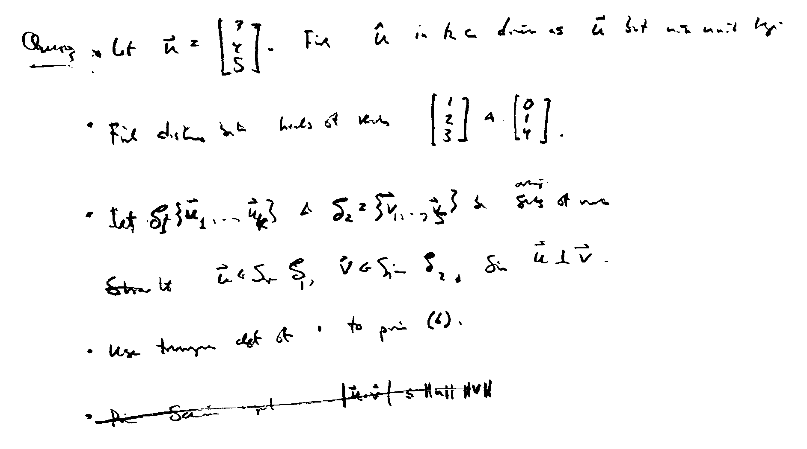

::: {.callout-note .legacy appearance="simple"}
This post is from the blog I kept as Preceptor in Mathematics at Harvard (2005–2008). It's kept here as an archive; some links are dead and references are dated.
:::

There’s an interesting [article](http://www.washingtonpost.com/wp-dyn/content/article/2006/10/10/AR2006101001475_pf.html) in the Washington Post this morning about cursive writing and how it’s going by the wayside. With so many other things to teach, and the prevalence of word processing for hard-copy writing, penmanship doesn’t seem to have a high priority. On the last SAT test, only 15% of the students wrote their essays in cursive. The rest printed–block letters.

I’m instinctually inclined to say that this is just this week’s sign of the coming apocalypse, but I can’t really bring myself to care that much. While I agree penmanship is a virtue, is it more important than math? {width="218" height="120" align="right"}Of course, I’m one to talk. My chicken-scratch is so horrible that my notes have a half-life. After a year I can’t read it anymore.
