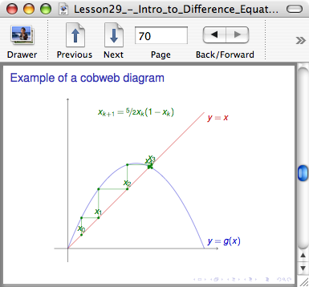
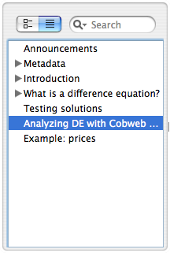

::: {.callout-note .legacy appearance="simple"}
This post is from the blog I kept as Preceptor in Mathematics at Harvard (2005–2008). It's kept here as an archive; some links are dead and references are dated.
:::

One of the most useful little LaTeX packages is [hyperref](http://www.tug.org/applications/hyperref/). In it normal use it doesn’t involve any new commands. However, it adds hyperlinks to references in the resulting PDF or HTML document.

This means if you use a PDFLaTex and this package, you get the bookmarked outline view of the PDF for free. Other references, like to the bibliography or to sections of the document, are now clickable as well. All this extra functionality for one line of code!

\
`\usepackage{hyperref}`

This is so useful it makes make want to re-LaTeX files I find that don’t include it.
