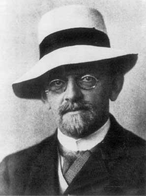
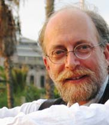

::: {.callout-note .legacy appearance="simple"}
This post is from the blog I kept as Preceptor in Mathematics at Harvard (2005–2008). It's kept here as an archive; some links are dead and references are dated.
:::

[David Hilbert (1862-1943)](http://en.wikipedia.org/wiki/David_Hilbert), legendary and influential mathematician:

[{width="182"}](http://en.wikipedia.org/wiki/David_Hilbert)

[[David Hilbert](http://www.csiro.au/people/David.Hilbert.html), Principal Research Scientist, CSIRO Sustainable Ecosystems:]{.caption}

[]{.caption}
