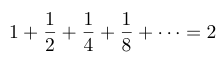
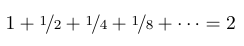

::: {.callout-note .legacy appearance="simple"}
This post is from the blog I kept as Preceptor in Mathematics at Harvard (2005–2008). It's kept here as an archive; some links are dead and references are dated.
:::

[This](http://texcatalogue.sarovar.org/entries/units.html) is a sweet little package to make your LaTeX mathematics prettier. It provides a command \\nicefrac that writes fractions with a diagonal dividing line rather than numerator strictly above the denominator. So rather than type\
$$ 1 + \frac{1}{2} + \frac{1}{4} + \frac{1}{8} + \cdots = 2$$ to get

\
you can type ` `$$ 1 + \nicefrac{1}{2} + \nicefrac{1}{4} + \nicefrac{1}{8} + \cdots = 2 $$ to get

(The package comes bundled with the units package that helps typeset units. That one’s pretty cool, too.)

**Update**: Shout-out to [Axel Reichert](http://www.axel-reichert.de/) for writing the package.
