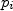
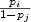

::: {.callout-note .legacy appearance="simple"}
This post is from the blog I kept as Preceptor in Mathematics at Harvard (2005–2008). It's kept here as an archive; some links are dead and references are dated.
:::

The [2007 NBA Draft Lottery](http://www.nba.com/features/draft2007.html) was last night and has a nice little probability problem in it. Although it’s pretty painful if you’re a Grizzlies or Celtics fan.

Most professional leagues have a policy of awarding the top picks to the worst teams. But the NBA wanted to discourage tanking a season to get a top pick, and so removed this certainty by instituting a [draft lottery](http://en.wikipedia.org/wiki/NBA_Draft_Lottery) to award the top three picks. Teams with worse records are weighted to have a higher probability of winning, but the weights are small enough to make the top pick to the worst team far from certain:

Here’s what actually happened, along with the probability of winning for each team:

<table width="228" cellspacing="1" cellpadding="2" bgcolor="#ffffff" align="center">
<tbody>
<tr bgcolor="#990000">
<td align="center" colspan="3">

::: {style="font-size: 10px; font-family: verdana; color: rgb(255, 255, 255);"}
**LOTTERY RESULTS**
:::

</td>
</tr>
<tr bgcolor="#cccccc">
<td align="center">

::: {style="font-size: 10px; font-family: verdana;"}
**TEAM**
:::

</td>
<td align="center">

::: {style="font-size: 10px; font-family: verdana;"}
**REC.**
:::

</td>
<td align="center">

::: {style="font-size: 10px; font-family: verdana;"}
**ODDS**
:::

</td>
</tr>
<tr bgcolor="#eeeeee">
<td>

::: {style="font-size: 10px; font-family: verdana;"}
**1. [Portland](http://www.math.harvard.edu/blazers/)**
:::

</td>
<td align="right">

::: {style="font-size: 10px; font-family: verdana;"}
32-50
:::

</td>
<td align="right">

::: {style="font-size: 10px; font-family: verdana;"}
5.3%
:::

</td>
</tr>
<tr bgcolor="#ffffff">
<td>

::: {style="font-size: 10px; font-family: verdana;"}
**2. [Seattle](http://www.math.harvard.edu/sonics/)**
:::

</td>
<td align="right">

::: {style="font-size: 10px; font-family: verdana;"}
31-51
:::

</td>
<td align="right">

::: {style="font-size: 10px; font-family: verdana;"}
8.8%
:::

</td>
</tr>
<tr bgcolor="#eeeeee">
<td>

::: {style="font-size: 10px; font-family: verdana;"}
**3. [Atlanta](http://www.math.harvard.edu/hawks/)**
:::

</td>
<td align="right">

::: {style="font-size: 10px; font-family: verdana;"}
30-52
:::

</td>
<td align="right">

::: {style="font-size: 10px; font-family: verdana;"}
11.9%
:::

</td>
</tr>
<tr bgcolor="#ffffff">
<td>

::: {style="font-size: 10px; font-family: verdana;"}
**4. [Memphis](http://www.math.harvard.edu/grizzlies/)**
:::

</td>
<td align="right">

::: {style="font-size: 10px; font-family: verdana;"}
22-60
:::

</td>
<td align="right">

::: {style="font-size: 10px; font-family: verdana;"}
25.0%
:::

</td>
</tr>
<tr bgcolor="#eeeeee">
<td>

::: {style="font-size: 10px; font-family: verdana;"}
**5. [Boston](http://www.math.harvard.edu/celtics/)**
:::

</td>
<td align="right">

::: {style="font-size: 10px; font-family: verdana;"}
24-58
:::

</td>
<td align="right">

::: {style="font-size: 10px; font-family: verdana;"}
19.9%
:::

</td>
</tr>
<tr bgcolor="#ffffff">
<td>

::: {style="font-size: 10px; font-family: verdana;"}
**6. [Milwaukee](http://www.math.harvard.edu/bucks/)**
:::

</td>
<td align="right">

::: {style="font-size: 10px; font-family: verdana;"}
28-54
:::

</td>
<td align="right">

::: {style="font-size: 10px; font-family: verdana;"}
15.6%
:::

</td>
</tr>
<tr bgcolor="#eeeeee">
<td>

::: {style="font-size: 10px; font-family: verdana;"}
**7. [Minnesota](http://www.math.harvard.edu/timberwolves/)**
:::

</td>
<td align="right">

::: {style="font-size: 10px; font-family: verdana;"}
32-50
:::

</td>
<td align="right">

::: {style="font-size: 10px; font-family: verdana;"}
5.3%
:::

</td>
</tr>
<tr bgcolor="#ffffff">
<td>

::: {style="font-size: 10px; font-family: verdana;"}
**8. [Charlotte](http://www.math.harvard.edu/bobcats/)**
:::

</td>
<td align="right">

::: {style="font-size: 10px; font-family: verdana;"}
33-49
:::

</td>
<td align="right">

::: {style="font-size: 10px; font-family: verdana;"}
1.9%
:::

</td>
</tr>
<tr bgcolor="#eeeeee">
<td>

::: {style="font-size: 10px; font-family: verdana;"}
**9. [New York^1^](http://www.math.harvard.edu/bulls/)**
:::

</td>
<td align="right">

::: {style="font-size: 10px; font-family: verdana;"}
33-49
:::

</td>
<td align="right">

::: {style="font-size: 10px; font-family: verdana;"}
1.9%
:::

</td>
</tr>
<tr bgcolor="#ffffff">
<td>

::: {style="font-size: 10px; font-family: verdana;"}
**10. [Sacramento](http://www.math.harvard.edu/kings/)**
:::

</td>
<td align="right">

::: {style="font-size: 10px; font-family: verdana;"}
33-49
:::

</td>
<td align="right">

::: {style="font-size: 10px; font-family: verdana;"}
1.8%
:::

</td>
</tr>
<tr bgcolor="#eeeeee">
<td>

::: {style="font-size: 10px; font-family: verdana;"}
**11. [Atlanta (via IND)](http://www.math.harvard.edu/hawks/)**
:::

</td>
<td align="right">

::: {style="font-size: 10px; font-family: verdana;"}
35-47
:::

</td>
<td align="right">

::: {style="font-size: 10px; font-family: verdana;"}
0.8%
:::

</td>
</tr>
<tr bgcolor="#ffffff">
<td>

::: {style="font-size: 10px; font-family: verdana;"}
**12. [Philadelphia](http://www.math.harvard.edu/sixers/)**
:::

</td>
<td align="right">

::: {style="font-size: 10px; font-family: verdana;"}
35-47
:::

</td>
<td align="right">

::: {style="font-size: 10px; font-family: verdana;"}
0.7%
:::

</td>
</tr>
<tr bgcolor="#eeeeee">
<td>

::: {style="font-size: 10px; font-family: verdana;"}
**13. [New Orleans](http://www.math.harvard.edu/hornets/)**
:::

</td>
<td align="right">

::: {style="font-size: 10px; font-family: verdana;"}
39-43
:::

</td>
<td align="right">

::: {style="font-size: 10px; font-family: verdana;"}
0.6%
:::

</td>
</tr>
<tr bgcolor="#ffffff">
<td>

::: {style="font-size: 10px; font-family: verdana;"}
**14. [L.A. Clippers](http://www.math.harvard.edu/clippers/)**
:::

</td>
<td align="right">

::: {style="font-size: 10px; font-family: verdana;"}
40-42
:::

</td>
<td align="right">

::: {style="font-size: 10px; font-family: verdana;"}
0.5%
:::

</td>
</tr>
</tbody>
</table>

As you can see, none of the teams with the worst three records (Memphis, Boston, and Milwaukee), and thus the biggest probabilities of winning, ended up with any of the top three picks. Mathematicians often get the FAQ “What are the odds of *that*?” Well, let’s see.

Let {align="absmiddle"} be the probability that the team with the *i*th worst record wins the lottery.  The second pick is determined by the same rules, except that the team that got the first pick can’t get the second pick.  So the probability that team *j* (i.e., the team with the *j*th worst record) gets the second pick, given that team *i* got the first pick is {align="absmiddle"}.  The third pick is assigned the same way. So the probability that team *i* gets the first pick, team *j* gets the second pick, and team *k* gets the third pick is

 = p_i \cdot \frac{p_j}{1-p_i} \cdot \frac{p_k}{1-p_i-p_j}\,\,."){align="absmiddle"}

All the other teams are assigned picks according to worst record among those remaining.  So there’s no more probability to be determined.

From the above you can see that the probability of the lottery ending up *precisely this way* is f(6,5,4) = 0.00068228, or .068%.  Very unlikely.  But so is the most likely event that the worst teams gets the first pick, the second-worst the second pick, and the third-worst the third pick.  That’s f(1,2,3) = 1.88%.   The more interesting event is that *none* of the worst three teams got *any* of the top picks.  The probability of that is the sum

\,\,."){align="absmiddle"}

over all triples (i,j,k) of distinct elements from the set 4, 5, 6, …, 14.  There are (11)(10)(9)=990 such triples.  There might be a nice combinatorial way to get a closed-form expression for this sum,  or you can just use Mathematica to do it.  I got 0.0405467, or 4.05%.  Not that likely, but you would expect it to happen about once every 25 years.  The lottery in its current form has been around since 1990.

Rich Zuckerman at NBC Sports published a [table](http://www.nbcsports.com/nba/1516303/detail.html) of the likelihood of all the bottom fourteen teams getting any of the lottery picks.  The event that no bottom-three team gets a top-three pick is equivalent to the event that the third-worst team gets the sixth pick (think about that for a while).  He’s got the same 4.05% figure in that position.

Is the draft lottery a good idea?  The math is there, and those who make the rules should be content with the consequences.   If having as “unfair” a distribution of picks as this occuring this often is acceptable to the team management, then they should keep it as it is.  But the lottery was instituted to discourage teams from “tanking” (not trying to win games) the rest of the season so as to increase their draft position.  I’m not sure it does.  In a non-lottery system, the team with the worst record is awarded the first pick.  In a lottery system, the team with the worst record is awarded the highest *probability* of the first pick.  Among the available choices, that’s still the most attractive, so bad teams still have the incentive to try to have the worst record.  But teams who legitimately “earn” the worst record are no more likely to be rewarded with high draft picks.  So this system doesn’t reward the honest, or punish the dishonest, it just makes the crime pay less.

(I said earlier that this is particularly painful to Celtics fans.  I live in the Boston area, but I am not a Celtics fan. I do sympathize with them, though.   My point of view on the lottery is really only based in mathematics and, I guess, game theory.)

.
