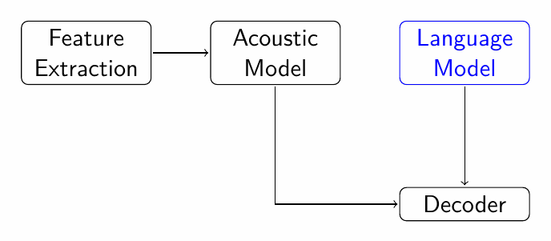

<!-- DRAFT written with Claude. Check the TODO comments, and put the history in
     your own words. Publish this together with the 2010 answer, which links here. -->

In 2010 someone asked on TeX Stack Exchange how to highlight a TikZ node on a
later beamer slide, the way `<alert@2>` highlights an item in a list. [My
answer](/blog/answers/2010-11-29-tex-how-to-make-beamer-overlays-with-tikz-node/)
([original on TeX.SE](https://tex.stackexchange.com/questions/6135/how-to-make-beamer-overlays-with-tikz-node/6155#6155))
defined a TikZ key that takes a beamer overlay specification as one of its arguments:

```latex
\tikzset{onslide/.code args={<#1>#2}{%
  \only<#1>{\pgfkeysalso{#2}} % \pgfkeysalso doesn't change the path
}}
```

so that `onslide=<3->{red}` makes a node red from slide 3 on.

That idea, along with its explanatory comment, was picked up and extended. 
As the answer grew in upvotes, I realized that it would make a good package for 
CTAN. But it languished on my “SOMEDAY: Summer” to-do list for years.

When I finally got around to it, I realized I didn't have to. The
[`aobs-tikz`](https://ctan.org/pkg/aobs-tikz) package by Claudio Fiandrino
provides a TikZ library, `overlay-beamer-styles`, which in turn provides several
keys with beamer overlay specifications as arguments. The documentation
describes the implementation as building on an [answer by TeX.SE user
Daniel](https://tex.stackexchange.com/a/55849/1402):

```latex
\tikzset{
    invisible/.style={opacity=0},
    visible on/.style={alt={#1{}{invisible}}},
    alt/.code args={<#1>#2#3}{%
      \alt<#1>{\pgfkeysalso{#2}}{\pgfkeysalso{#3}} % \pgfkeysalso doesn't change the path
    },
  }
```

The `alt` key expects three arguments. The first is a beamer overlay
specification to feed to `\alt`. The next two are the key/values to be set in
case the overlay specification is or is not active. The `invisible` style uses
opacity to make the rest of the TikZ path invisible. Then `visible on` takes an
overlay specification (including the angle brackets) and sets the `invisible`
style when that specification is not active.

I recognized my comment and asked Claudio if he would mind acknowledging my
original answer along with Daniel's innovation.

Now in 2026, my beamer slide decks make frequent use of this library instead of
my hand-rolled solution. This one line of TikZ code is probably among the
greatest-impact contributions in my academic career.

## The same frame, today

Here is the example from the original answer, using the `overlay-beamer-styles`
library instead. It also addresses another annoyance: different TikZ styles
might change the node size, which can complicate relative positioning.

```latex
\documentclass{beamer}
\usepackage{tikz}
\usetikzlibrary{overlay-beamer-styles, positioning}

\tikzset{
  highlight/.style={red, ultra thick},
  system/.style={
    draw, rectangle, rounded corners=3pt,
    minimum width=2cm, text width=1.8cm, align=center,
    outer sep=1pt, % fixed, so thick borders don't move the anchors
  },
}

\begin{document}
\begin{frame}
  \centering
  \begin{tikzpicture}[node distance=2.4cm and 3cm, on grid]
    \node [system, alt=<3->{highlight}{}] (fe) {Feature Extraction};
    \node [system, alt={<2,4>{green}{}}, right=of fe]
      (am) {Acoustic Model};
    \node [system, right=of am,
           alt=<-2>{blue}{}, alt=<3>{highlight}{}, alt=<4>{green}{}]
      (lm) {Language Model};
    \node [system, below=of lm] (d) {Decoder};

    \draw [->] (fe) -- (am);
    \draw [->] (am) |- (d);
    \draw [->] (lm) -- (d);

    % pin the bounding box, so beamer doesn't re-center a picture
    % that grew because of a thick border
    \pgfresetboundingbox
    \useasboundingbox (fe.north west) rectangle (lm.east |- d.south);
  \end{tikzpicture}
\end{frame}
\end{document}
```

{fig-alt="Animation cycling through four beamer slides of a block diagram (Feature Extraction, Acoustic Model, Language Model, Decoder). Slide 1: Language Model is blue. Slide 2: Acoustic Model turns green. Slide 3: Feature Extraction and Language Model are thick and red. Slide 4: Feature Extraction stays red; Acoustic Model and Language Model are green. The boxes stay in exactly the same place on every slide."}

The library's `alt=<spec>{keys}{other keys}` applies `keys` on the slides in
`spec` and `other keys` everywhere else. It covers both of the keys I defined in
2010: `onslide=<3->{highlight}` becomes `alt=<3->{highlight}{}`, and my
three-way `temporal` key becomes three `alt`s. In addition to `visible
on=<spec>`, which reveals an element without moving anything else, the library
provides keys like `fill on`, `draw on`, and `text on` for switching between a
normal and a "background" style.

The comma quirk is still there, though. An overlay specification with a comma,
like `<2,4>`, requires all three arguments to be wrapped in braces
(`alt={<2,4>{green}{}}`). TikZ splits its options at commas before the key ever sees them.
Without the braces, the parser tries to send `<2` only to `alt`, and `4>{green}{}` as a separate key. 
This 

The original answer ended by warning that the picture
would jiggle when a border got thicker, and suggested avoiding relative
positioning. The real culprits are two side effects of the line width:

- TikZ puts a node's anchors half a line width outside its border, so a
  thicker border moves the anchors, and any node positioned relative to them.
  Setting `outer sep` to a fixed value at least half the thickest line width
  (`ultra thick` is 1.6pt) stops that. Positioning with `on grid` (center to
  center) helps too.
- A thicker border also makes the picture's bounding box bigger, and beamer
  re-centers the bigger picture. Pinning the bounding box to the (now fixed)
  node anchors stops that.

Relative positioning is fine after all.

Smaller modernizations: `\tikzset{highlight/.style=...}` replaces the
deprecated `\tikzstyle`, `align=center` replaces `text centered`, and
`\centering` replaces the `figure` and `centering` environments.

<!-- TODO: anything else you'd do differently now? e.g. whether you still use
     beamer for teaching, or other tools you'd reach for. -->
