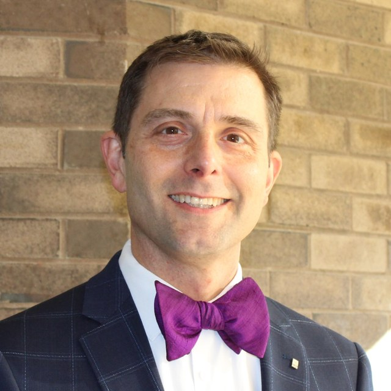

::: {.hero}
{fig-alt="Photograph of Matthew Leingang"}

::: {.hero-text}
[Matthew Leingang]{.hero-name}

[Mathematics educator · academic leader · builder of teaching tools]{.hero-role}

[Email](mailto:) ·
[CV](cv.qmd) ·
[LinkedIn](https://www.linkedin.com/in/matthewleingang/) ·
[GitHub](https://github.com/leingang)
:::
:::

<!-- DRAFT bio: edit freely. Facts come from the CV (leingang/cv, 2024). -->

I'm a mathematician, and I've spent 25 years making undergraduate mathematics
teaching better: in my own classroom, in the courses I've coordinated, and
through the instructors I've trained.

I am **** at New York University, where I have been
on the faculty since 2008. For fifteen years I was **Vice Chair for
Undergraduate Affairs**, directing a service-level program that teaches about
7,000 students a year in calculus, precalculus, discrete mathematics,
quantitative reasoning, and linear algebra. I built a common syllabus and
coordination system for Calculus I–III, led a team of a dozen clinical
faculty, ran training for graduate teaching assistants, postdocs, and
undergraduate tutors, and handled student affairs from honors to academic
integrity. From 2023 to 2025 I shared that work as one of two **Assistant
Directors for Undergraduate Studies**, focusing on the introductory division.

In 2012 I founded **NYU GSTEM**, a six-week summer research and mentoring
program that has served close to 400 high school students, supported by a
grant from the Alfred P. Sloan Foundation. In 2017 I received the
**Distinguished Teaching Award** of the MAA Metropolitan New York Section,
and in 2024 the **Golden Dozen Teaching Award** of NYU's College of Arts and
Science.

Before NYU I was Preceptor in Mathematics at Harvard University (2003–2008),
where I ran pre-service and in-service training for graduate student
teachers, and Hill Assistant Professor at Rutgers University (2000–2003) on
an NSF VIGRE postdoctoral fellowship. I earned my Ph.D. in mathematics from
Harvard (symplectic geometry) and my A.B. from the University of Chicago.

## What I work on

- **Leading undergraduate programs.** Multi-section courses that stay
  consistent without becoming rigid, curriculum development, learning
  outcomes assessment, and student affairs. See [Teaching](teaching.qmd).
- **Preparing instructors.** Training graduate teaching assistants and new
  faculty, including research on how TAs develop pedagogical content
  knowledge.
- **Broadening participation.** Mentoring and summer programs that bring
  more students into STEM.
- **Tools for teaching.** Software that takes the drudgery out of running
  courses. See [Projects](projects.qmd).
- **Writing and speaking.** On inquiry-based learning, assessment, and
  technology in the classroom. See [Talks & Workshops](talks.qmd) and
  [Writing](blog/index.qmd).

## Contact


